# Architecture: Integrated Test-Driven Development for Spec Kit

**Feature**: `001-integrated-tdd` | **Date**: 2026-10-10
**Feature docs**: [Spec](./spec.md) | [Plan](./plan.md) |
[Data model](./data-model.md) | [Contracts](./contracts/)
**System views**: not yet created. `docs/architecture/context.md`, `containers.md` and
`erd.md` do not exist, so every person, external system, container and entity below is new.
The [Architecture Impact](#architecture-impact) table is the input for creating them.

## Components

The system is delivered as two Spec Kit packages and keeps its data in the adopting
project's feature directory. That gives three containers. The two packages each get a
component view. The third, Feature Artefacts, is a file store and has no components; its
contents are in [Data](#data).

### Integrated TDD Preset

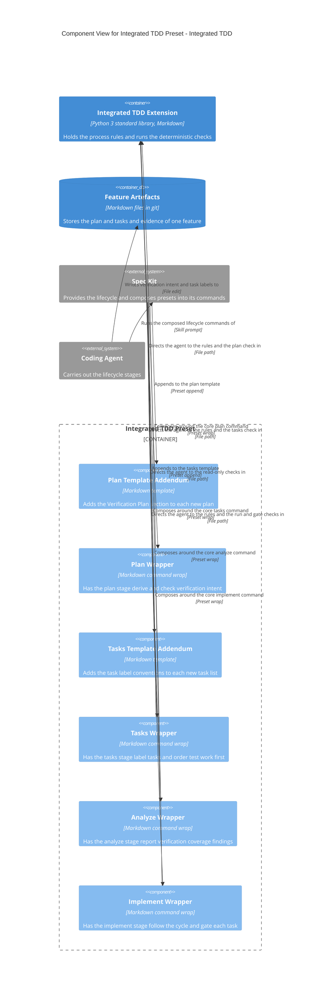

| Component | Responsibility | Technology | Status | Source location |
|-----------|----------------|------------|--------|-----------------|
| Plan Template Addendum | Adds the empty Verification Plan section, with its three tables, to the end of the plan template | Markdown, preset `append` | New | `preset/templates/plan-addendum.md` |
| Plan Wrapper | Declares the Verification Plan as a Phase 1 output; has the agent derive obligations from requirements and design, record exemptions, raise material ambiguity with the developer, and run the `plan` check | Markdown, preset `wrap` | New | `preset/commands/speckit.plan.md` |
| Tasks Template Addendum | Adds the `[VO-nnn]` and `[NT: reason]` label conventions to the end of the tasks template | Markdown, preset `append` | New | `preset/templates/tasks-addendum.md` |
| Tasks Wrapper | Makes test tasks mandatory for behaviour, has every task labelled and ordered test-first, and runs the `tasks` check | Markdown, preset `wrap` | New | `preset/commands/speckit.tasks.md` |
| Analyze Wrapper | Adds the `plan` and `tasks` findings to the analysis report without modifying anything | Markdown, preset `wrap` | New | `preset/commands/speckit.analyze.md` |
| Implement Wrapper | Has the agent record a baseline, work each task through Red, Green, Refactor using `run`, classify failures, record exceptions and decisions, run the gate before marking a task complete, and report what was and was not verified | Markdown, preset `wrap` | New | `preset/commands/speckit.implement.md` |

### Integrated TDD Extension

```mermaid
C4Component
    title Component View for Integrated TDD Extension - Integrated TDD

    Container_Boundary(tddExtension, "Integrated TDD Extension") {
        Component(processRules, "Process Rules", "Markdown template", "States the agent-neutral rules for the cycle and its exceptions")
        Component(gateHandler, "Gate Event Handler", "Markdown command file", "Binds the pre tool use event to the hook entry point")
        Component(checkCli, "Check CLI", "Python 3 argparse", "Parses subcommands and reports findings and exit codes")
        Component(hookAdapter, "Hook Adapter", "Python 3", "Turns an agent tool call payload into a file and its resulting content")
        Component(traceChecks, "Trace Checks", "Python 3", "Checks requirement coverage and task labels and task order")
        Component(gateRules, "Gate Rules", "Python 3", "Decides whether a task or a whole feature meets the process rules")
        Component(commandRunner, "Command Runner", "Python 3 subprocess", "Runs a declared verification command and observes its result")
        Component(evidenceLedger, "Evidence Ledger", "Python 3", "Appends evidence entries and regenerates the review summary")
        Component(artefactParser, "Artefact Parser", "Python 3", "Reads the verification plan and task labels and evidence tables")
        Component(evidenceTemplate, "Evidence Template", "Markdown template", "Holds the starting content of an evidence document")
    }

    ContainerDb(featureArtefacts, "Feature Artefacts", "Markdown files in git", "Stores the plan and tasks and evidence of one feature")
    System_Ext(codingAgent, "Coding Agent", "Carries out the lifecycle stages")
    System_Ext(specKit, "Spec Kit", "Provides the lifecycle and composes presets into its commands")
    System_Ext(projectTestTooling, "Project Test Tooling", "The adopting project's own test frameworks and verification commands")

    Rel(codingAgent, processRules, "Reads the rules in", "File read")
    Rel(codingAgent, checkCli, "Runs checks and recordings through", "Shell command")
    Rel(specKit, gateHandler, "Dispatches the pre tool use event to", "Event dispatcher")
    Rel(gateHandler, checkCli, "Names the hook subcommand of", "Script frontmatter")
    Rel(checkCli, hookAdapter, "Passes the tool call payload to")
    Rel(hookAdapter, gateRules, "Requests a gate decision from")
    Rel(checkCli, traceChecks, "Delegates plan and tasks checks to")
    Rel(checkCli, gateRules, "Delegates gate and compliance checks to")
    Rel(checkCli, commandRunner, "Delegates test runs to")
    Rel(checkCli, evidenceLedger, "Delegates exceptions and decisions to")
    Rel(commandRunner, projectTestTooling, "Executes the declared command in", "Subprocess")
    Rel(commandRunner, evidenceLedger, "Records the outcome through")
    Rel(traceChecks, artefactParser, "Reads artefacts through")
    Rel(gateRules, artefactParser, "Reads artefacts through")
    Rel(evidenceLedger, evidenceTemplate, "Creates the document from", "File read")
    Rel(evidenceLedger, featureArtefacts, "Appends to tdd-evidence.md in", "File write")
    Rel(artefactParser, featureArtefacts, "Reads spec.md and plan.md and tasks.md and tdd-evidence.md from", "File read")
```

| Component | Responsibility | Technology | Status | Source location |
|-----------|----------------|------------|--------|-----------------|
| Process Rules | The single statement of the process: deriving verification intent, the cycle, test integrity, failure classification, exceptions, when to ask a person, and what may be reported. Read by all four wrapped commands | Markdown, extension template | New | `templates/tdd-process-rules.md` |
| Gate Event Handler | Carries the `scripts:` frontmatter that Spec Kit's event dispatcher resolves for the `pre_tool_use` event. Not registered as a command | Markdown command file | New | `commands/speckit.integrated-tdd.gate.md` |
| Check CLI | Entry point: subcommand parsing, feature directory resolution, text and JSON output, exit codes | Python 3, `argparse` | New | `scripts/python/tdd_check.py` (`main`, subcommand handlers) |
| Hook Adapter | The only agent-specific code: reads the Claude Code `PreToolUse` payload, computes the content the edit would produce, and finds tasks newly marked complete | Python 3 | New | `scripts/python/tdd_check.py` (hook section) |
| Trace Checks | Rules C1 to C3: requirement coverage, task labelling, test-before-behaviour order | Python 3 | New | `scripts/python/tdd_check.py` (trace section) |
| Gate Rules | Rules G1 to G9 per task and C4 to C7 per feature; derives obligation status | Python 3 | New | `scripts/python/tdd_check.py` (rules section) |
| Command Runner | Resolves a declared command, substitutes the selector, executes it, checks the expected failure text, and fingerprints the test files | Python 3, `subprocess`, `hashlib` | New | `scripts/python/tdd_check.py` (run section) |
| Evidence Ledger | The only writer of `tdd-evidence.md`: appends records, exceptions, expectation changes and decisions, chains check values, and regenerates the Summary | Python 3 | New | `scripts/python/tdd_check.py` (ledger section) |
| Artefact Parser | Reads requirement ids from `spec.md`, the Verification Plan from `plan.md`, task lines from `tasks.md` and the tables of `tdd-evidence.md` | Python 3, `re` | New | `scripts/python/tdd_check.py` (parsing section) |
| Evidence Template | The headings and empty tables a new `tdd-evidence.md` starts from | Markdown, extension template | New | `templates/tdd-evidence-template.md` |

## Flows

All flows are drawn at container level, because each one crosses the coding agent, the two
packages and the feature's files. Messages to the extension are subcommands of the
[check script](./contracts/check-cli.md).

### Flow 1: Verification intent is derived during plan and tasks (User Story 1)

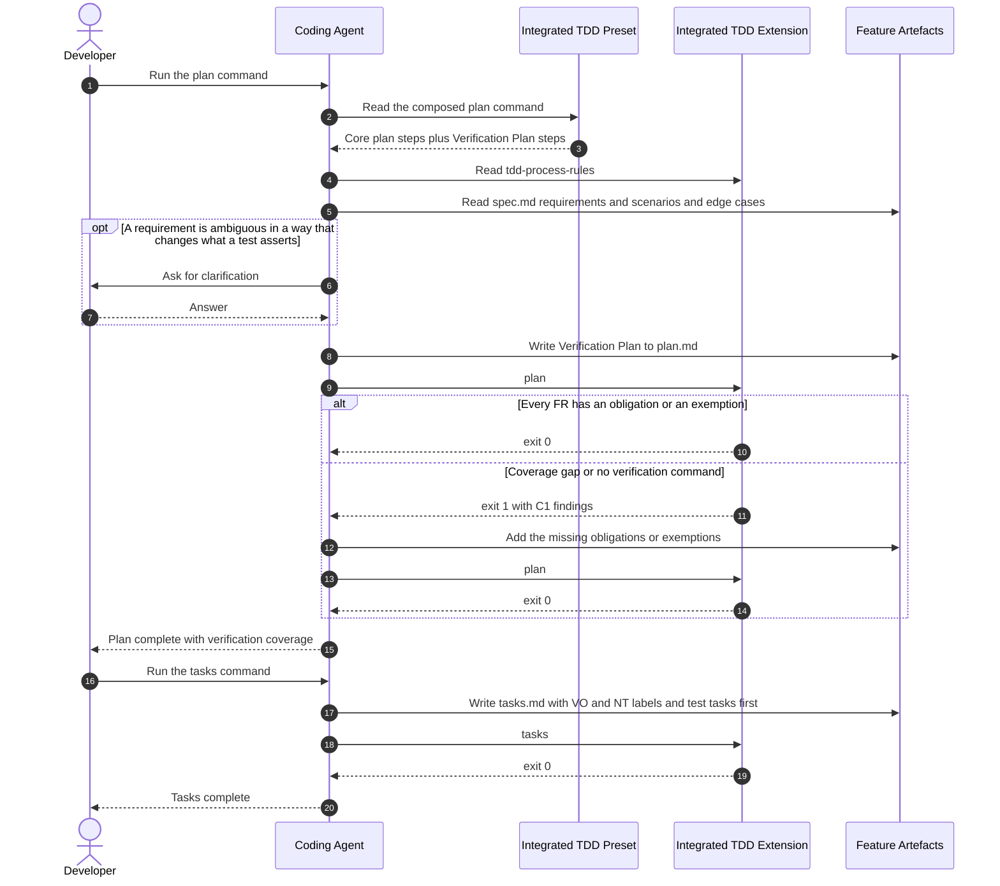

**Covers**: FR-002, FR-006 to FR-015, SC-001; User Story 1 acceptance scenarios 1 to 5.
**Notes**: The check is repeated until it passes; the stage does not report completion on
a failing check. Proportion (FR-013) is the agent's judgement on how many obligations a
requirement needs, and the check only requires that each requirement has at least one or
an exemption.

### Flow 2: One task through Red, Green, Refactor (User Story 2)

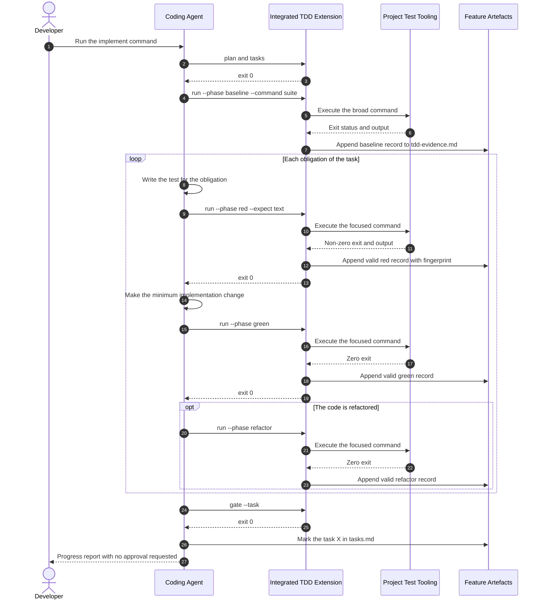

**Covers**: FR-017 to FR-022, FR-024 to FR-028, FR-053, FR-062, SC-003, SC-007; User Story
2 acceptance scenarios 1 to 5 and 7.
**Notes**: A broad `checkpoint` run follows the last task of each phase and is not shown.
The edit that marks the task complete passes through the runtime event shown in Flow 3. No output is stored beyond the
matched expected text.

### Flow 3: A task is marked complete without evidence (User Story 2, failure path)

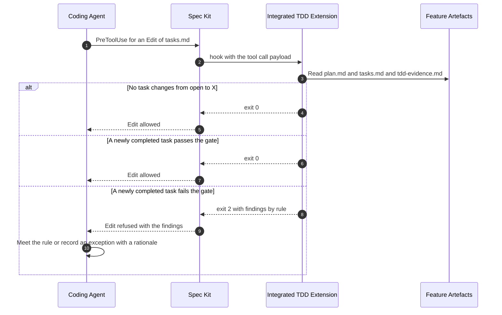

**Covers**: FR-059, FR-060, FR-061; the edge case for a task reaching completion without
its evidence.
**Notes**: Spec Kit here is its generated event dispatcher, `.specify/events.py`, which
Claude Code calls from `.claude/settings.json`. The handler runs no tests and returns
within the 30 second event timeout. An edit to `tdd-evidence.md` takes the same path and is
always refused. Edits made through a shell command do not raise this event; the final
`gate --all` in the implement stage and the compliance check catch them afterwards.

### Flow 4: A test changes between Red and Green (User Story 3)

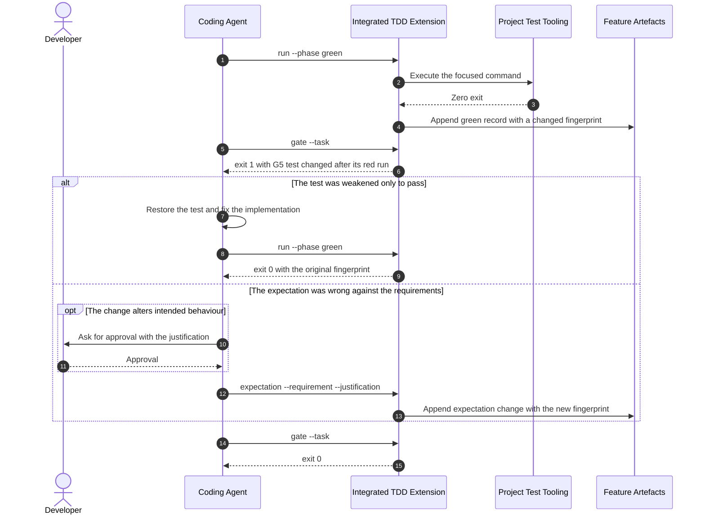

**Covers**: FR-029, FR-031, FR-032, FR-035, SC-004; User Story 3 acceptance scenarios 1
and 2.
**Notes**: The fingerprint shows that a test changed, not whether the change weakened it.
Whether assertions are meaningful (FR-030) and whether test doubles hide boundary failures
(FR-033) are rules the agent follows from the process rules and a reviewer assesses; no
check claims to decide them.

### Flow 5: A blocked run, an exception and a decision (User Story 4)

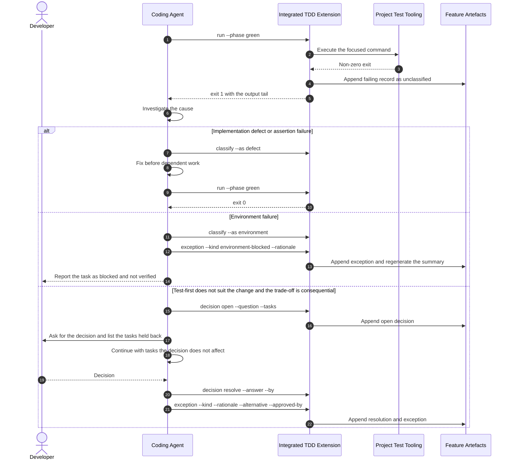

**Covers**: FR-023, FR-026, FR-036 to FR-040, FR-052, FR-065, SC-006; User Story 4
acceptance scenarios 1 to 5.
**Notes**: While a decision is open, gate rule G2 fails for every task it lists, so the
runtime event refuses to mark them complete. When every remaining task is listed, the
agent stops and reports. An `environment-blocked` exception leaves the task incomplete.

### Flow 6: A reviewer reads what was verified (User Story 5)

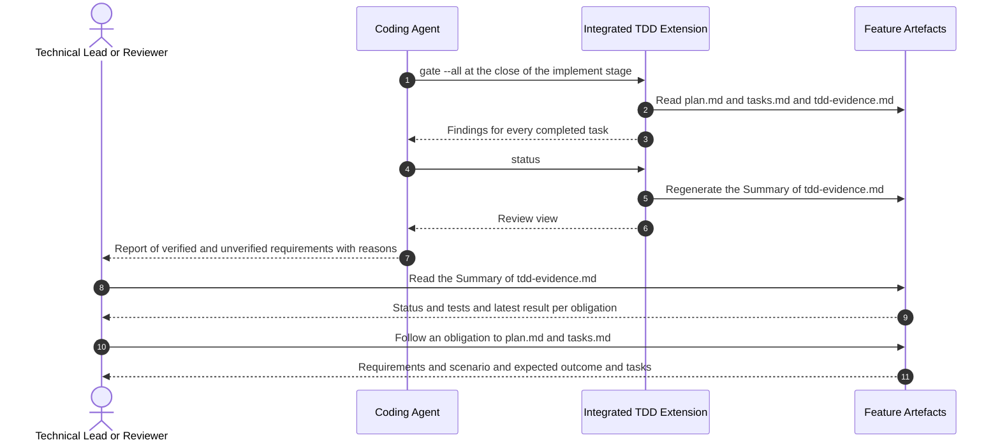

**Covers**: FR-034, FR-041 to FR-045, FR-047, FR-051, FR-054, FR-063, SC-005; User Story 5
acceptance scenarios 1, 2, 4 and 5.
**Notes**: The reviewer runs nothing. The Summary is rewritten on every write to the
evidence document, so it cannot lag behind the records. It refers to requirements, tasks
and tests by identifier and copies none of their content.

### Flow 7: The extension is installed into a project (User Story 6)

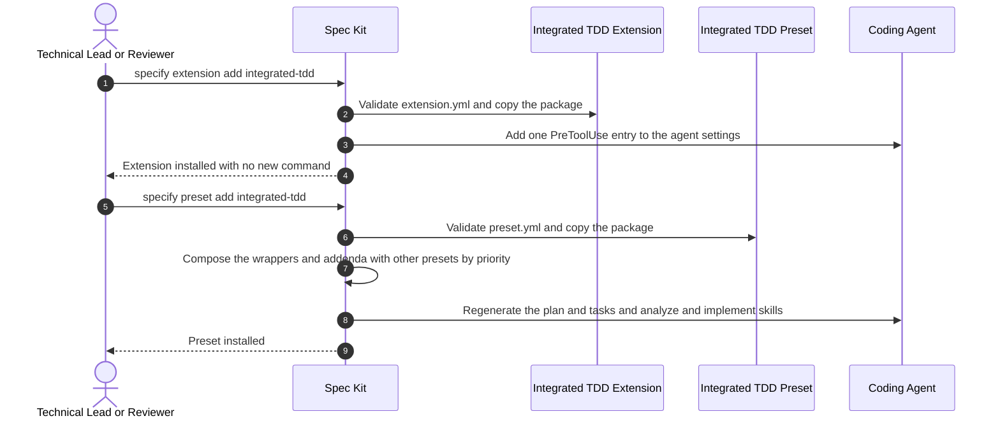

**Covers**: FR-001, FR-003, FR-005, FR-046, FR-048, FR-050, SC-002, SC-009; User Story 6
acceptance scenarios 2, 5 and 6.
**Notes**: Nothing in the project's test, lint or CI configuration is read or written at
installation. Removal reverses steps 2, 3, 6 and 8 through Spec Kit's own remove commands.
The project's verification commands enter at the plan stage, in Flow 1.

### Flow 8: An evaluator checks a finished run (User Story 7)

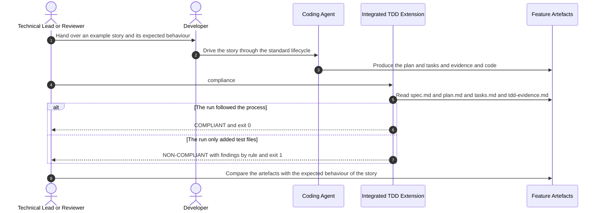

**Covers**: FR-055 to FR-058, FR-064, SC-010, SC-011; User Story 7 acceptance scenarios 1
to 4.
**Notes**: The compliance check is the gate rules applied to the whole feature, so it
cannot disagree with what the gate enforced. It is not called by any lifecycle command. A
run that only added test files has completed behaviour tasks with no valid red record,
which fails rule C5 through G3.

## Data

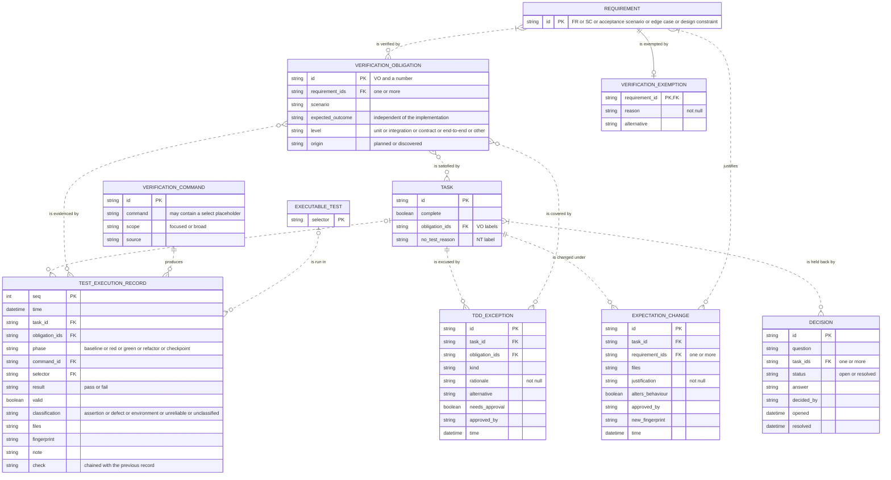

| Entity | Status | Stored in | Notes |
|--------|--------|-----------|-------|
| REQUIREMENT | Existing | Feature Artefacts: `spec.md`, and design constraints named in `plan.md` | Owned by Spec Kit. Read only; shown with its key |
| VERIFICATION_COMMAND | New | Feature Artefacts: `plan.md`, Verification Plan | At least one row required |
| VERIFICATION_OBLIGATION | New | Feature Artefacts: `plan.md`, Verification Plan | Identifiers are never reused. Status is derived, not stored |
| VERIFICATION_EXEMPTION | New | Feature Artefacts: `plan.md`, Verification Plan | Keyed by the requirement it exempts |
| TASK | Changed | Feature Artefacts: `tasks.md` | Owned by Spec Kit. Gains the `[VO-nnn]` and `[NT: reason]` labels |
| EXECUTABLE_TEST | Existing | The adopting project's source tree | Not stored by this feature; referred to by selector. Shown with its key |
| TEST_EXECUTION_RECORD | New | Feature Artefacts: `tdd-evidence.md` | Append-only, written only by the check script |
| TDD_EXCEPTION | New | Feature Artefacts: `tdd-evidence.md` | Approval required when flagged |
| EXPECTATION_CHANGE | New | Feature Artefacts: `tdd-evidence.md` | Approval required when it alters behaviour |
| DECISION | New | Feature Artefacts: `tdd-evidence.md` | Not named as an entity in the specification; modelled for FR-065 |

Lists of identifiers are held in one table cell, which is how a many-to-many relationship
is stored in Markdown, so no join entities appear. Review Evidence from the data model is a
generated view and is left out as a derived object.

## Architecture Impact

No project-level views exist, so every row is an addition.

| View | Change | Element | Detail |
|------|--------|---------|--------|
| Context | Add | Integrated TDD (the system) | The preset and extension together, with the feature artefacts they keep |
| Context | Add | Developer (person) | Runs the standard lifecycle commands, answers clarification requests, approves consequential exceptions and behaviour-altering expectation changes |
| Context | Add | Technical Lead or Reviewer (person) | Installs and removes the packages, reads the evidence at review, runs the compliance check when evaluating |
| Context | Add | Coding Agent (external system) | Carries out the lifecycle stages, runs the check script, and has its tool calls gated. Claude Code in the first release |
| Context | Add | Spec Kit (external system) | Composes the preset into core commands and templates, registers the extension, dispatches the runtime event |
| Context | Add | Project Test Tooling (external system) | The adopting project's own verification commands, executed by the extension |
| Context | Add | Project Quality Controls (external system) | The adopting project's linting, static analysis, security scanning and CI. No relationship with the system: it neither calls them nor is called by them, and they stay in force beside it |
| Containers | Add | Integrated TDD Preset | Markdown, Spec Kit preset. Wraps four core commands and appends to two core templates |
| Containers | Add | Integrated TDD Extension | Python 3 standard library and Markdown, Spec Kit extension. Process rules, evidence template, check script, runtime event handler |
| Containers | Add | Feature Artefacts | Markdown files in git. One feature's `spec.md`, `plan.md`, `tasks.md` and `tdd-evidence.md` |
| Containers | Add | Spec Kit to Integrated TDD Preset | Composes into the core commands and templates. Preset wrap and append |
| Containers | Add | Spec Kit to Integrated TDD Extension | Dispatches the pre tool use event to. Event dispatcher |
| Containers | Add | Coding Agent to Spec Kit | Runs the composed lifecycle commands of. Skill prompt |
| Containers | Add | Coding Agent to Integrated TDD Extension | Reads the rules in, and runs checks and recordings through. File read, shell command |
| Containers | Add | Coding Agent to Feature Artefacts | Writes verification intent and task labels to. File edit |
| Containers | Add | Integrated TDD Preset to Integrated TDD Extension | Directs the agent to the rules and checks in. File path |
| Containers | Add | Integrated TDD Extension to Feature Artefacts | Reads the artefacts from, and appends evidence to. File read and write |
| Containers | Add | Integrated TDD Extension to Project Test Tooling | Executes declared verification commands in. Subprocess |
| ERD | Add | VERIFICATION_COMMAND, VERIFICATION_OBLIGATION, VERIFICATION_EXEMPTION | New entities in `plan.md`, with the relationships shown above |
| ERD | Add | TEST_EXECUTION_RECORD, TDD_EXCEPTION, EXPECTATION_CHANGE, DECISION | New entities in `tdd-evidence.md`, with the relationships shown above |
| ERD | Add | REQUIREMENT, TASK, EXECUTABLE_TEST | Entities owned by Spec Kit or the adopting project, added to the view because the new entities refer to them. TASK gains `obligation_ids` and `no_test_reason` |
