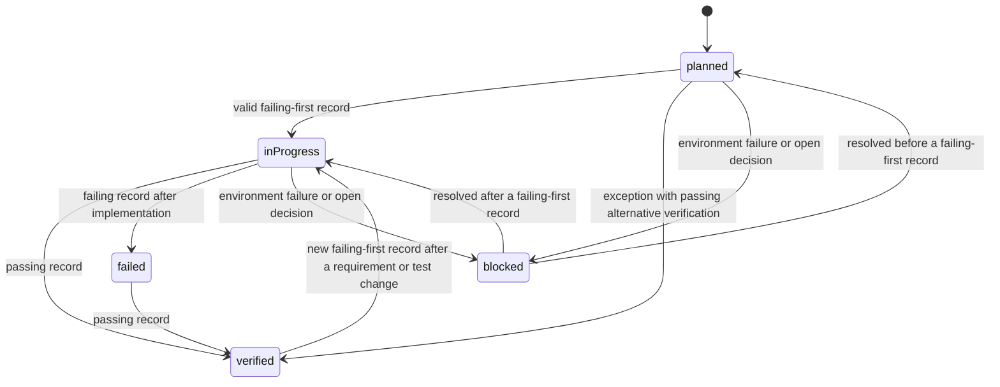
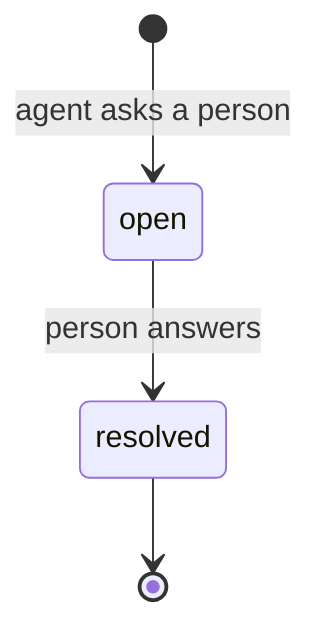

# Data Model: Integrated Test-Driven Development for Spec Kit

**Feature**: `001-integrated-tdd` | **Date**: 2026-10-10 | **Plan**: [plan.md](./plan.md)

All data is held as Markdown in the adopting project's feature directory and versioned
with it. There is no database. "Stored in" names the document and section; exact table
layouts are in [contracts/artefact-formats.md](./contracts/artefact-formats.md).

## Entities

### Requirement

A functional requirement, acceptance scenario, edge case, failure condition or success
criterion from `spec.md`, or a constraint from the technical design. Owned by Spec Kit; this feature reads
it and never writes it.

| Field | Type | Notes |
|-------|------|-------|
| id | string | Key. `FR-012`, `SC-003`, `US2-AS3` for acceptance scenario 3 of user story 2, `EC-04` for an edge case and `DC-02` for a design constraint, both labels the agent assigns in the plan |
| source | string | `spec.md` or `plan.md` |

**Rules**: every `FR-` identifier and every acceptance scenario in `spec.md` must be
covered by at least one Verification Obligation or one Verification Exemption (FR-007,
FR-009, SC-001). The script derives a scenario's id from its user story heading and its
number in that story's Acceptance Scenarios list. Edge cases, which the specification does
not number, and design constraints are covered where the agent judges them applicable.
Their `EC-` and `DC-` ids are labels the agent assigns in the plan, with the edge case or
constraint stated in the obligation's scenario; the script accepts them without looking
them up. `FR-`, `SC-` and acceptance scenario ids must exist in `spec.md`, and an id with
any other prefix is an error.

### Verification Command

A way the adopting project already runs its tests.

| Field | Type | Notes |
|-------|------|-------|
| id | string | Key. Short lowercase name, for example `unit` or `suite` |
| command | string | The project's own command line. May contain `{select}` |
| scope | enum | `focused` (run per increment) or `broad` (run at checkpoints) |
| source | string | Where in the project the command is defined, for example `package.json scripts.test` |

**Stored in**: `plan.md`, Verification Plan, Verification commands table.

**Rules**: at least one command must be declared (FR-049, first edge case). The check
script runs no command that is not in this table.

### Verification Obligation

A statement that particular requirements must be verified by a scenario with an expected
outcome.

| Field | Type | Notes |
|-------|------|-------|
| id | string | Key. `VO-001`, numbered in order of creation and never reused |
| requirement_ids | list of string | One or more Requirement ids |
| scenario | string | The situation to test, in terms of behaviour |
| expected_outcome | string | What must be observed, stated without reference to the implementation (FR-010) |
| level | enum | `unit`, `integration`, `contract`, `end-to-end` or `other` (FR-011) |
| origin | enum | `planned`, or `discovered` when added during implementation (FR-016) |

**Stored in**: `plan.md`, Verification Plan, Verification obligations table.

**Status is derived, not stored** (FR-045):

| Status | Condition |
|--------|-----------|
| planned | No valid record or exception refers to the obligation |
| in progress | A valid failing-first record exists and no later passing record |
| verified | A valid failing-first record is followed by a passing record with no unrecorded test change, or an exception with an alternative verification covers it and that verification passed |
| blocked | The latest record is a failure classified `environment`, or an open decision covers its task |
| failed | The latest record is a failure classified `assertion` or `defect` |

### Verification Exemption

A decision made in planning that a requirement will not be verified automatically.

| Field | Type | Notes |
|-------|------|-------|
| requirement_id | string | Key. The Requirement exempted |
| reason | string | Why automated verification is inappropriate |
| alternative | string | How it is verified instead, or `none` with the reason |

**Stored in**: `plan.md`, Verification Plan, Verification exemptions table.

**Rules**: a requirement appears in obligations, in exemptions, or both; never in neither.

### Task

A unit of work in `tasks.md`. Owned by Spec Kit; this feature adds labels to it.

| Field | Type | Notes |
|-------|------|-------|
| id | string | Key. `T012`, as Spec Kit numbers it |
| complete | boolean | The `[ ]` or `[X]` checkbox |
| kind | enum | `test`, `behaviour` or `no-test`, from its labels |
| obligation_ids | list of string | `[VO-003]` labels. Required for `test` and `behaviour` tasks |
| no_test_reason | string | The text of a `[NT: reason]` label. Required for `no-test` tasks |

**Stored in**: `tasks.md`.

**Rules**:

- Every task carries at least one `[VO-nnn]` label or one `[NT: reason]` label (FR-012,
  and the edge case for tasks with no behaviour to test).
- For each obligation, a `test` task that names it appears before the first `behaviour`
  task that names it (FR-012).
- Every obligation is named by at least two tasks, a `test` task and a `behaviour` task.
  The passing run is required of the `behaviour` task, so an obligation with one task
  would never need one (FR-020, SC-003). This holds for work under an exception too: the
  first task establishes the starting evidence and the second carries the passing run. One
  exception naming the obligation covers both tasks.
- A task changes from incomplete to complete only when the task gate passes (FR-060).

### Executable Test

A runnable check in the adopting project's own test tooling. It lives in the project's
source tree and is not stored by this feature.

| Field | Type | Notes |
|-------|------|-------|
| selector | string | Key. The text substituted for `{select}`, for example `tests/test_cart.py::test_empty_cart_total` |
| files | list of string | Paths of the test files, relative to the repository root, used for fingerprints |

**Rules**: referred to from Test Execution Records. The link from an obligation to its
executable tests is the set of selectors on that obligation's records (FR-041).

### Test Execution Record

A summary of one real test run. Written only by the check script.

| Field | Type | Notes |
|-------|------|-------|
| seq | integer | Key. Starts at 1, increases by 1 |
| time | datetime | UTC, ISO 8601 |
| task_id | string | The Task being worked on. Empty for a baseline or checkpoint |
| obligation_ids | list of string | The obligations the run concerns. Empty for a baseline or checkpoint |
| phase | enum | `baseline`, `red`, `green`, `refactor`, `checkpoint` |
| command_id | string | A Verification Command id |
| selector | string | The Executable Test selector, or empty for the whole command |
| result | enum | `pass`, `fail` |
| valid | boolean | Whether the record counts as evidence for its phase |
| classification | enum | For a failure: `assertion`, `defect`, `environment`, `unreliable`, or `unclassified` until the agent classifies it. `defect` is the specification's implementation defect. Empty for a pass. Set once, after the run |
| files | list of string | Paths of the test files the run was fingerprinted over. Named with `--tests` for a `red` record; copied from the obligation's latest valid `red` record for a `green` or `refactor` record made without `--tests`. Empty when there are none |
| fingerprint | string | Short hash over the paths and current contents of `files`. Empty when `files` is empty |
| note | string | One line. For an invalid record, why it is invalid. May be extended when the record is classified |
| check | string | Short hash of this row's other fields, except classification and note, chained with the previous row's check |

**Stored in**: `tdd-evidence.md`, Test execution records table, append-only.

**Rules**:

- `phase` maps to the specification's cycle points: `red` is failing-first, `green` is
  passing, `refactor` is post-refactor, `checkpoint` is a broad-suite run (FR-062).
  `baseline` records the state before the feature's work, so that pre-existing failures are
  kept apart from new ones.
- A `red` record is valid only when the run exited non-zero and its output contained the
  expected failure text the agent supplied (FR-018). A `red` run that passes is recorded as
  invalid with the note "passed on first run" and must be investigated.
- A `green` or `refactor` record is valid only when the run exited zero (FR-020, FR-021).
- A valid `red` record is classified `assertion` by the script. Any other failure is
  written as `unclassified`, and the agent classifies it once it has investigated
  (FR-036).
- A record classified `unreliable` is never valid, in either direction.
- A `checkpoint` record must use a command whose scope is `broad` (FR-028).
- A `baseline` record must exist before any other record is made. The script refuses a
  `red`, `green`, `refactor` or `checkpoint` run until one does (the edge case for tests
  already failing before the feature began).
- Full test output is never stored (FR-062).

### TDD Exception

A recorded departure from the test-first cycle for a piece of work.

| Field | Type | Notes |
|-------|------|-------|
| id | string | Key. `EX-01` |
| task_id | string | The Task it was raised on |
| obligation_ids | list of string | The obligations it covers, for every task that names them. May be empty when the task is `no-test`, and the exception then applies to that task only |
| kind | enum | `no-meaningful-red`, `behaviour-preserving`, `legacy`, `external-system`, `generated-code`, `migration`, `infrastructure`, `exploratory`, `environment-blocked`, `other` |
| rationale | string | Why the cycle was not followed. Required |
| alternative | string | The verification followed instead. Required except for `environment-blocked` |
| needs_approval | boolean | Always true for kinds `legacy`, `exploratory` and `other`, and when the alternative is `none`; the script sets it. For any other kind, set by the agent when the departure involves a consequential trade-off |
| approved_by | string | The person who approved it. Required when `needs_approval` is true |
| time | datetime | UTC |

**Stored in**: `tdd-evidence.md`, Exceptions table.

**Rules**:

- An exception replaces the requirement for a valid `red` record on the obligations it
  covers. It does not replace the requirement for a passing run, except for
  `environment-blocked`, which leaves the obligation blocked and every task that names it
  incomplete.
- A `behaviour-preserving` exception requires a passing record before the change (phase
  `baseline` or `green`) and a passing `refactor` record after it, on the same selector
  (the specification's edge case for refactors and optimisations).
- An exception with `needs_approval` true and no `approved_by` does not satisfy the gate
  (FR-052). The gate also reads the kind and the alternative, so an exception of kind
  `legacy`, `exploratory` or `other`, or with the alternative `none`, needs an approver
  whatever its flag says.

### Expectation Change

A recorded change to what a test expects after its failing-first run.

| Field | Type | Notes |
|-------|------|-------|
| id | string | Key. `XC-01` |
| task_id | string | The Task during which the test changed |
| files | list of string | The test files that changed |
| requirement_ids | list of string | The requirements the change is justified against. At least one |
| justification | string | Why the expectation was wrong or has changed |
| alters_behaviour | boolean | Whether the change alters intended behaviour, as judged by the agent |
| approved_by | string | Required when `alters_behaviour` is true (FR-032) |
| new_fingerprint | string | The fingerprint the gate accepts from now on |
| time | datetime | UTC |

**Stored in**: `tdd-evidence.md`, Expectation changes table.

**Rules**: a fingerprint difference between an obligation's latest valid `red` record,
which is made on its `test` task, and the later `green` record made on a `behaviour` task
fails the gate for that `behaviour` task unless an Expectation Change for it carries the
new fingerprint, and carries an approval when `alters_behaviour` is true.

### Decision

A clarification or approval requested from a person during implementation (FR-052,
FR-065). The gate depends on it. An ambiguity found during planning is not a Decision: it
is answered before the obligation is written, and the `plan` check fails until then.

| Field | Type | Notes |
|-------|------|-------|
| id | string | Key. `DN-01` |
| question | string | What the person is asked to decide |
| task_ids | list of string | The affected task and every task that depends on it |
| status | enum | `open`, `resolved` |
| answer | string | The decision. Required when resolved |
| decided_by | string | Required when resolved |
| opened | datetime | UTC |
| resolved | datetime | UTC. Empty while open |

**Stored in**: `tdd-evidence.md`, Decisions table.

**Rules**: a task listed on an open decision cannot pass the gate. Tasks not listed
continue (FR-065).

### Review Evidence

The view a reviewer uses. It is generated by the check script into the Summary section at
the top of `tdd-evidence.md` each time the script writes to the file, and by the `status`
subcommand on demand. It is derived entirely from the entities above and has no fields of
its own, so it is not a stored entity. The stored Summary is a view and never an input:
every check derives status from `plan.md` and the tables. It can fall behind when `plan.md`
changes after the last write; the compliance check reports that (C7), and the next
recording run rewrites it.

It shows, per Verification Obligation: the requirements covered, the derived status, the
executable tests, and the latest result. It then lists unverified requirements with the
reason, exemptions, exceptions, expectation changes, open decisions, and pre-existing
failures from the baseline (FR-043, SC-005, SC-006).

## Relationships

| From | To | Cardinality | Meaning |
|------|----|-------------|---------|
| Verification Obligation | Requirement | many to many | An obligation verifies one or more requirements; a requirement may need several obligations |
| Verification Exemption | Requirement | one to one | An exemption exempts one requirement |
| Task | Verification Obligation | many to many | A task satisfies obligations; an obligation has a test task and one or more behaviour tasks |
| Test Execution Record | Task | many to zero or one | A record is made while working on a task, or on none for a baseline or checkpoint |
| Test Execution Record | Verification Obligation | many to many | A record is evidence for obligations |
| Test Execution Record | Verification Command | many to one | A record was produced by running one declared command |
| Test Execution Record | Executable Test | many to zero or one | A record ran the tests a selector chooses |
| TDD Exception | Task | many to one | An exception is raised on one task |
| TDD Exception | Verification Obligation | many to many | An exception covers obligations, for every task that names them |
| Expectation Change | Task | many to one | A change was made during one task |
| Expectation Change | Requirement | many to many | A change is justified against requirements |
| Decision | Task | many to many | A decision holds back the tasks it lists |

## The task gate

The rule set applied when a task is about to be marked complete, and applied to every
completed task by the end-of-stage gate and the compliance check. Each rule has an
identifier that appears in the gate's output.

| Rule | Applies to | Condition for passing |
|------|------------|-----------------------|
| G1 | every task | The task carries a `[VO-nnn]` or `[NT: reason]` label |
| G2 | every task | No open Decision lists the task |
| G3 | `test` and `behaviour` tasks | Each obligation on the task has a valid `red` record, or is named by an Exception, whichever of the obligation's tasks it was raised on |
| G4 | `behaviour` tasks | Each obligation on the task has a valid `green` record later than its `red` record or its Exception |
| G5 | `behaviour` tasks | For each obligation on the task that has a valid `red` record, the fingerprint of its latest `green` record equals that of its latest valid `red` record, or an Expectation Change for the task carries the new fingerprint |
| G6 | every task | The latest record for the task is not a failure, other than a valid `red` record on a `test` task, and no failure record for the task is `unclassified` |
| G7 | every task | Each Exception raised on the task or naming one of its obligations has a rationale, an alternative where required, and an approval where flagged or where its kind or a `none` alternative requires one |
| G8 | every task | Each Expectation Change on the task names a requirement and has an approval where it alters behaviour |
| G9 | every task | Every record for the task used a declared Verification Command |

A `test` task is complete when its tests exist and have been seen to fail for the intended
reason, so G4 and G5 do not apply to it.

The compliance check adds rules that concern the whole feature. Because a task's kind
follows from its position, C3 can fail only for tasks carrying several obligation labels
([artefact formats](./contracts/artefact-formats.md) section 2); the order of the failing
and passing runs is enforced by G3 and G4:

| Rule | Condition for passing |
|------|-----------------------|
| C1 | Every `FR-` requirement and every acceptance scenario has an obligation or an exemption |
| C2 | Every obligation is named by a `test` task and by at least one `behaviour` task |
| C3 | For each obligation, a `test` task precedes the first `behaviour` task |
| C4 | The chain of check values in the record table is intact |
| C5 | Every completed task passes G1 to G9 |
| C6 | A `baseline` record precedes every other record. At least one `checkpoint` record exists and the latest one passed, or the baseline run of the same command also failed and the Summary reports the failure as pre-existing |
| C7 | By derived status, no obligation is `planned` or `in progress`. The stored Summary equals the view regenerated from `plan.md` and the tables, apart from its generated-on line, so that every `failed` or `blocked` obligation appears in it as such |
