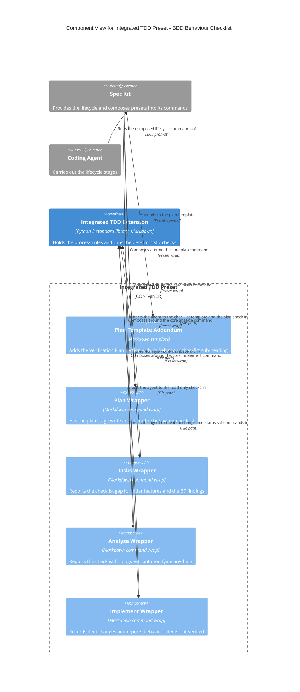
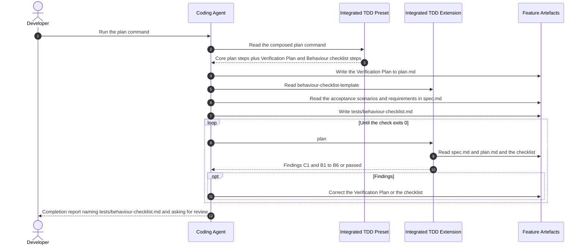
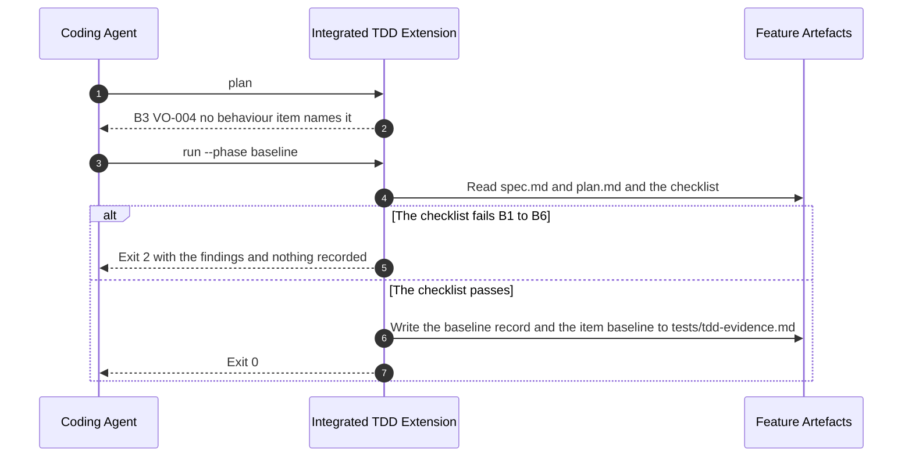
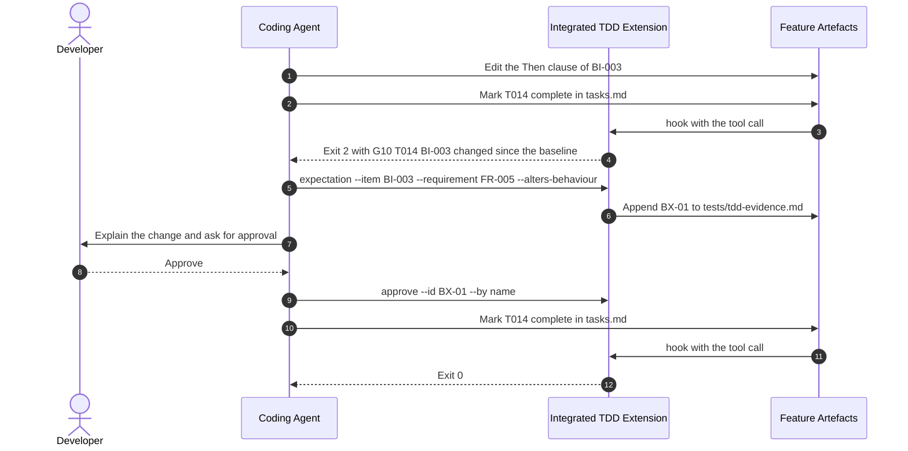
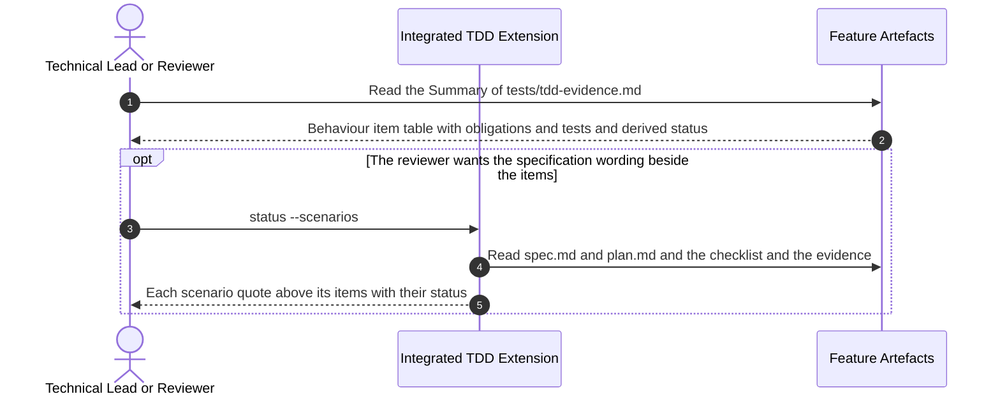
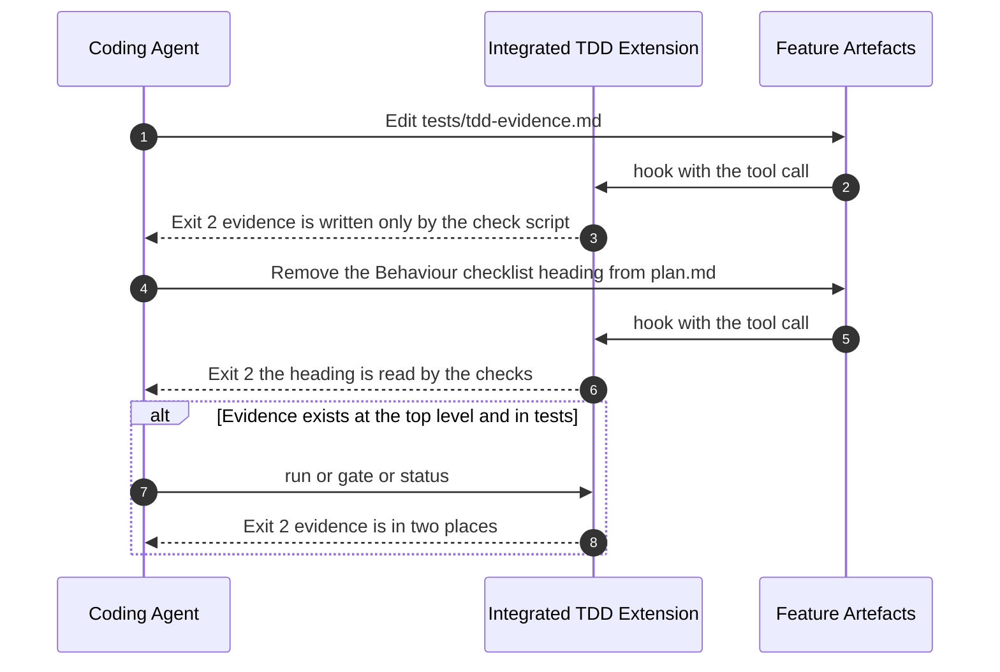
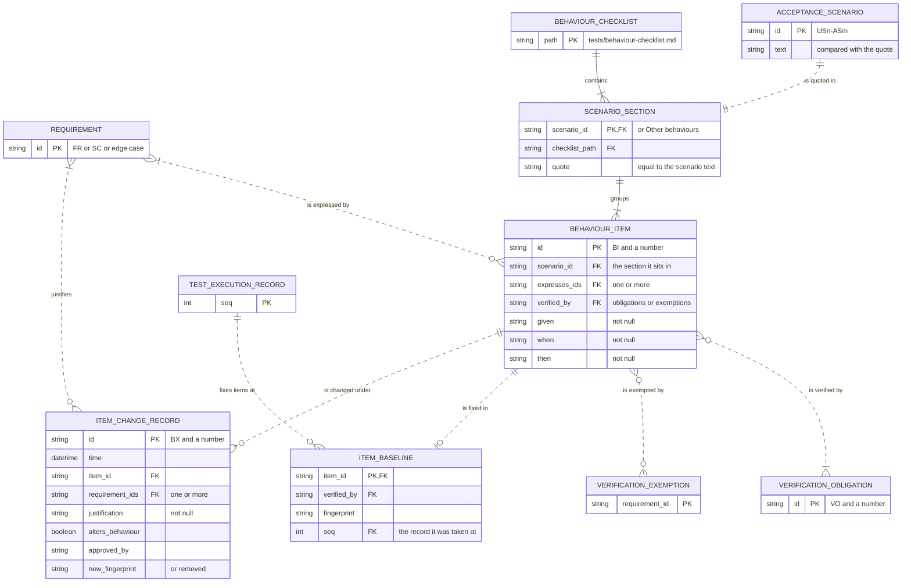

# Architecture: BDD Behaviour Checklist

**Feature**: `002-bdd-behaviour-checklist` | **Date**: 2026-10-16
**Feature docs**: [Spec](./spec.md) | [Plan](./plan.md) |
[Data model](./data-model.md) | [Contracts](./contracts/)
**System views**: not yet created. `docs/architecture/context.md`, `containers.md` and
`erd.md` do not exist; `/speckit-c4-system` has not yet been run for
[001-integrated-tdd](../001-integrated-tdd/architecture.md), whose element aliases and
labels are reused here unchanged. The [Architecture Impact](#architecture-impact) table
lists what this feature changes relative to 001.

## Components

The containers are those of 001: the Integrated TDD Preset, the Integrated TDD Extension,
and Feature Artefacts. No container is added. Both packages change, so each gets a
component view showing the components this feature adds or changes and their neighbours.
Feature Artefacts is a file store; its new contents are in [Data](#data).

### Integrated TDD Preset

| Component | Responsibility | Technology | Status | Source location |
|-----------|----------------|------------|--------|-----------------|
| Plan Template Addendum | Gains the `### Behaviour checklist` sub-heading and its fixed link inside the Verification Plan; the heading marks a feature as under the checklist rules | Markdown, preset `append` | Changed | `preset/templates/plan-addendum.md` |
| Plan Wrapper | Gains the step that writes `tests/behaviour-checklist.md` from the template, adds the sub-heading to a plan written before this change, and reports the checklist for review without requesting approval | Markdown, preset `wrap` | Changed | `preset/commands/speckit.plan.md` |
| Tasks Wrapper | Reports the missing checklist of an older feature as a gap; names B7 among the findings | Markdown, preset `wrap` | Changed | `preset/commands/speckit.tasks.md` |
| Analyze Wrapper | Reports the missing checklist as a gap; describes B1 to B7 among the findings it copies into the report | Markdown, preset `wrap` | Changed | `preset/commands/speckit.analyze.md` |
| Implement Wrapper | Names the refusals of baseline and Red runs, the recording of an item change, the evidence location, and the behaviour items in the final report | Markdown, preset `wrap` | Changed | `preset/commands/speckit.implement.md` |
| Tasks Template Addendum | One added sentence; not drawn, as its relationships are unchanged | Markdown, preset `append` | Changed | `preset/templates/tasks-addendum.md` |

**Layout**: not checked. The configured Mermaid CLI, `mmdc`, is not installed, so nothing
was rendered; the declaration order follows the ordering rules of the conventions.

### Integrated TDD Extension

```mermaid
C4Component
    title Component View for Integrated TDD Extension - BDD Behaviour Checklist

    Container_Boundary(tddExtension, "Integrated TDD Extension") {
        Component(processRules, "Process Rules", "Markdown template", "States the agent-neutral rules for the cycle and its exceptions")
        Component(checklistTemplate, "Behaviour Checklist Template", "Markdown template", "Holds the starting content of a behaviour checklist")
        Component(checkCli, "Check CLI", "Python 3 argparse", "Parses subcommands and reports findings and exit codes")
        Component(hookAdapter, "Hook Adapter", "Python 3", "Turns an agent tool call payload into a file and its resulting content")
        Component(traceChecks, "Trace Checks", "Python 3", "Checks requirement coverage and task labels and task order")
        Component(checklistChecks, "Checklist Checks", "Python 3", "Applies rules B1 to B7 and fingerprints behaviour items")
        Component(gateRules, "Gate Rules", "Python 3", "Decides whether a task or a whole feature meets the process rules")
        Component(commandRunner, "Command Runner", "Python 3 subprocess", "Runs a declared verification command and observes its result")
        Component(evidenceLedger, "Evidence Ledger", "Python 3", "Appends evidence entries and regenerates the review summary")
        Component(artefactParser, "Artefact Parser", "Python 3", "Reads the specification and plan and tasks and checklist and evidence")
    }

    ContainerDb(featureArtefacts, "Feature Artefacts", "Markdown files in git", "Stores the plan and tasks and checklist and evidence of one feature")
    System_Ext(codingAgent, "Coding Agent", "Carries out the lifecycle stages")

    Rel(codingAgent, processRules, "Reads the rules in", "File read")
    Rel(codingAgent, checklistTemplate, "Copies the checklist from", "File read")
    Rel(codingAgent, checkCli, "Runs checks and recordings through", "Shell command")
    Rel(codingAgent, featureArtefacts, "Writes the behaviour checklist to", "File edit")
    Rel(checkCli, hookAdapter, "Passes the tool call payload to")
    Rel(checkCli, traceChecks, "Delegates plan and tasks checks to")
    Rel(checkCli, gateRules, "Delegates gate and status and compliance to")
    Rel(checkCli, commandRunner, "Delegates test runs to")
    Rel(checkCli, evidenceLedger, "Delegates item changes and approvals to")
    Rel(hookAdapter, gateRules, "Requests a gate decision from")
    Rel(hookAdapter, artefactParser, "Reads the plan headings through")
    Rel(traceChecks, checklistChecks, "Adds the checklist rules from")
    Rel(gateRules, checklistChecks, "Applies G10, G11, C8 and item status through")
    Rel(commandRunner, checklistChecks, "Refuses a baseline or red run through")
    Rel(commandRunner, evidenceLedger, "Records the outcome and the item baseline through")
    Rel(checklistChecks, artefactParser, "Reads artefacts through")
    Rel(traceChecks, artefactParser, "Reads artefacts through")
    Rel(gateRules, artefactParser, "Reads artefacts through")
    Rel(evidenceLedger, featureArtefacts, "Writes tdd-evidence.md in tests of", "File write")
    Rel(artefactParser, featureArtefacts, "Reads the five feature documents from", "File read")
```

| Component | Responsibility | Technology | Status | Source location |
|-----------|----------------|------------|--------|-----------------|
| Process Rules | Gains the "Behaviour checklist" section: when and where it is written, the form of an item, what it must not name, wording closeness, proportion, no status, corrections through the specification, fixing at the baseline and changes afterwards | Markdown, extension template | Changed | `templates/tdd-process-rules.md` |
| Behaviour Checklist Template | The headings, comment and example section a new `tests/behaviour-checklist.md` starts from | Markdown, extension template | New | `templates/behaviour-checklist-template.md` |
| Check CLI | Gains `expectation --item`, `approve` for `BX-` ids and `status --scenarios`; resolves the evidence location once for every subcommand | Python 3, `argparse` | Changed | `scripts/python/tdd_check.py` (`main`, subcommand handlers) |
| Hook Adapter | Also guards `plan.md` against removing its two headings, and recognises `tests/tdd-evidence.md` with the parent as the feature directory | Python 3 | Changed | `scripts/python/tdd_check.py` (hook section) |
| Trace Checks | `plan` and `tasks` add the checklist findings when the rules apply | Python 3 | Changed | `scripts/python/tdd_check.py` (trace section) |
| Checklist Checks | Decides whether the rules apply; rules `CHECKLIST` and B1 to B7; B5 token shapes; quote normalisation; item fingerprints; item status from obligation status | Python 3, `re`, `hashlib` | New | `scripts/python/tdd_check.py` (checklist section) |
| Gate Rules | Gains G10, G11, C8 and the item table of the Review Evidence view | Python 3 | Changed | `scripts/python/tdd_check.py` (rules section) |
| Command Runner | Refuses a baseline while the checklist fails and a Red run for an obligation no item names | Python 3, `subprocess` | Changed | `scripts/python/tdd_check.py` (run section) |
| Evidence Ledger | Writes to the resolved evidence location, creating `tests/`; adds Item Baseline rows; writes the two new tables only when the rules apply; records item changes | Python 3 | Changed | `scripts/python/tdd_check.py` (ledger section) |
| Artefact Parser | Reads acceptance scenario text from `spec.md`, the sub-heading from `plan.md`, the checklist, and the two new evidence tables when present | Python 3, `re` | Changed | `scripts/python/tdd_check.py` (parsing section) |

The Gate Event Handler and the Evidence Template of 001 are unchanged and not drawn.

**Layout**: not checked, for the same reason as above.

## Flows

The flows are drawn at container level, as in 001, because each crosses the coding agent,
both packages and the feature's files. Messages to the extension are subcommands of the
check script ([changes](./contracts/check-cli-changes.md)).

### Flow 1: The plan stage writes and checks the behaviour checklist (User Stories 1 and 3)

**Covers**: FR-001, FR-003, FR-008 to FR-018, FR-019 to FR-025, FR-028, FR-029; US1
scenarios 1 to 6; US2 scenario 5; US3 scenario 3.
**Notes**: the report asks for review and waits for nothing (FR-029). A correction found in
review goes to `spec.md` or the Verification Plan first (FR-030), and the loop runs again.

### Flow 2: Implementation cannot start while the checklist fails (User Story 2)

**Covers**: FR-004, FR-025, FR-033 (fixing at the baseline), FR-041; US2 scenarios 1 to 4.

### Flow 3: A changed behaviour item holds its tasks (User Story 4)

**Covers**: FR-033, SC-007; US4 scenario 4.
**Notes**: the hook is dispatched by Spec Kit's event on the agent's edit, drawn here as a
message from the edit for brevity, as in 001. A correction that alters no behaviour needs
the record and no approval.

### Flow 4: A reviewer reads behaviour items with their evidence (User Story 4)

**Covers**: FR-017, FR-034, SC-003; US4 scenarios 1, 2 and 5.

### Flow 5: The evidence and the plan headings are guarded (FR-042, FR-044)

**Covers**: FR-042, FR-044, SC-011; EC-10.

User Story 5 is documentation and examples and has no runtime flow.

## Data

| Entity | Status | Stored in | Notes |
|--------|--------|-----------|-------|
| REQUIREMENT | Existing | Feature Artefacts: `spec.md` | Shown with its key |
| ACCEPTANCE_SCENARIO | Changed | Feature Artefacts: `spec.md` | Its text is now read, for rule B6. In 001 it was folded into REQUIREMENT; drawn apart here because it alone is quoted |
| BEHAVIOUR_CHECKLIST | New | Feature Artefacts: `tests/behaviour-checklist.md` | Written by the agent, read by the script. Holds no status |
| SCENARIO_SECTION | New | Feature Artefacts: the checklist | The Other behaviours section has no scenario and no quote |
| BEHAVIOUR_ITEM | New | Feature Artefacts: the checklist | Status is derived, not stored. Fingerprint is derived, not stored in the checklist |
| VERIFICATION_OBLIGATION | Existing | Feature Artefacts: `plan.md` | Shown with its key |
| VERIFICATION_EXEMPTION | Existing | Feature Artefacts: `plan.md` | Shown with its key |
| ITEM_BASELINE | New | Feature Artefacts: the evidence document, `## Behaviour items at baseline` | Written only by the script; rows are never changed |
| ITEM_CHANGE_RECORD | New | Feature Artefacts: the evidence document, `## Behaviour item changes` | Approval required when it alters behaviour |
| TEST_EXECUTION_RECORD | Existing | Feature Artefacts: the evidence document | Shown with its key. The evidence document moves to `tests/` for features with no evidence before this change |

Lists of identifiers are held in one cell or one line, as in 001, so no join entities
appear. Item Status and the Trace Link of the data model are derived and left out.

## Architecture Impact

Relative to the views 001 will create, since the project-level views do not yet exist.

| View | Change | Element | Detail |
|------|--------|---------|--------|
| Context | None | - | No person or external system is added. The Developer, the Technical Lead or Reviewer, the Coding Agent and Spec Kit take part as in 001 |
| Containers | Change | Feature Artefacts | Description becomes "Stores the plan and tasks and checklist and evidence of one feature"; it now includes a `tests/` folder in each feature directory |
| Containers | Change | Integrated TDD Extension to Feature Artefacts | The extension now reads the behaviour checklist and writes the evidence document in `tests/`; the label in 001 names `tdd-evidence.md` and should name both documents |
| Containers | Change | Coding Agent to Feature Artefacts | The agent also writes the behaviour checklist |
| ERD | Add | BEHAVIOUR_CHECKLIST, SCENARIO_SECTION, BEHAVIOUR_ITEM, ITEM_BASELINE, ITEM_CHANGE_RECORD | And their relationships to REQUIREMENT, VERIFICATION_OBLIGATION, VERIFICATION_EXEMPTION and TEST_EXECUTION_RECORD as drawn above |
| ERD | Change | ACCEPTANCE_SCENARIO | Separated from REQUIREMENT, with a `text` attribute |
