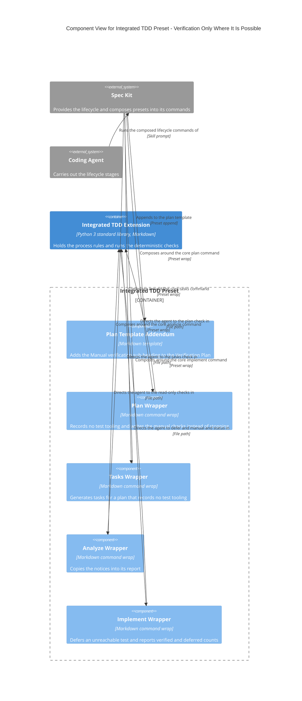
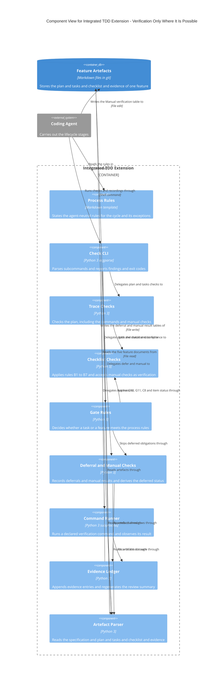
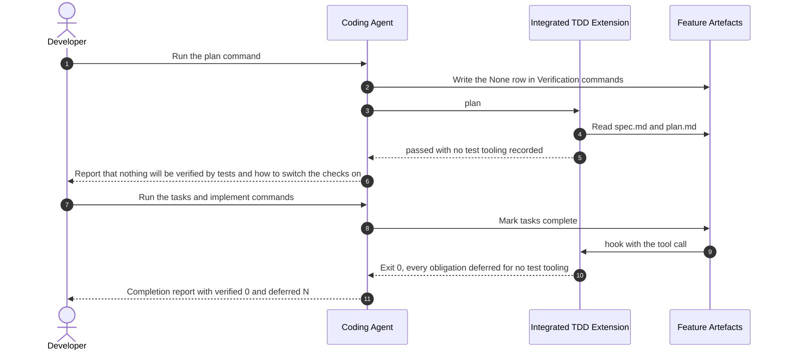
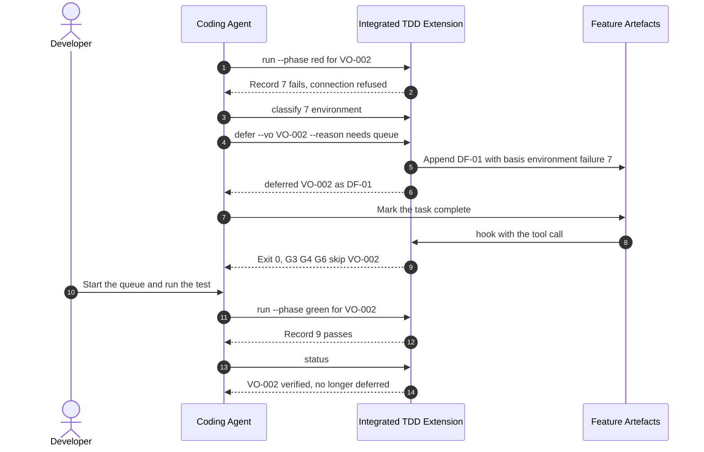
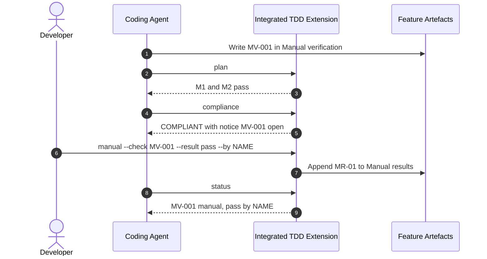
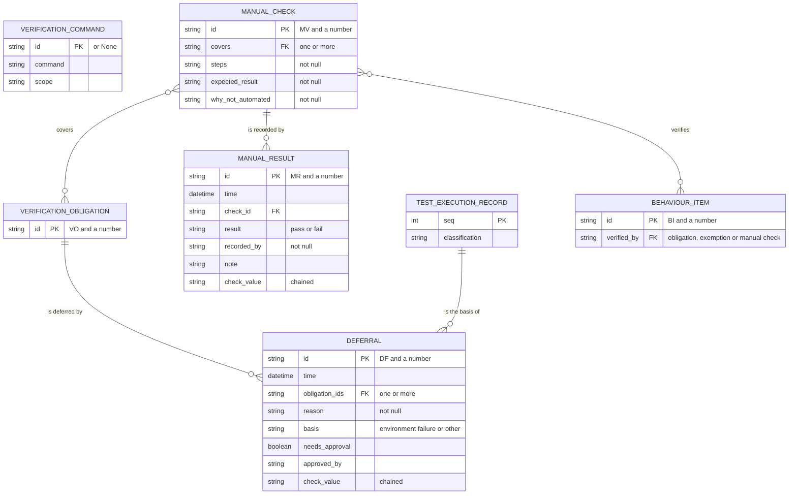

# Architecture: Verification Only Where It Is Possible

**Feature**: `003-no-tooling-manual-verification` | **Date**: 2026-10-17
**Feature docs**: [Spec](./spec.md) | [Plan](./plan.md) |
[Data model](./data-model.md) | [Contracts](./contracts/)
**System views**: not yet created. `docs/architecture/context.md`, `containers.md` and
`erd.md` do not exist; `/speckit-c4-system` has not yet been run for
[001](../001-integrated-tdd/architecture.md) or
[002](../002-bdd-behaviour-checklist/architecture.md), whose element aliases and labels are
reused here unchanged. The [Architecture Impact](#architecture-impact) table lists what this
feature changes relative to them.

## Components

The containers are those of 001: the Integrated TDD Preset, the Integrated TDD Extension and
Feature Artefacts. No container is added. Both packages change.

### Integrated TDD Preset

| Component | Responsibility | Technology | Status | Source location |
|-----------|----------------|------------|--------|-----------------|
| Plan Template Addendum | Gains the `### Manual verification` sub-heading and an empty table | Markdown, preset `append` | Changed | `preset/templates/plan-addendum.md` |
| Plan Wrapper | Writes the `None` commands row when there is no way to run tests, writes the Manual verification table, and counts both in the report | Markdown, preset `wrap` | Changed | `preset/commands/speckit.plan.md` |
| Tasks Wrapper | States that a plan recording no test tooling passes, so tasks are generated | Markdown, preset `wrap` | Changed | `preset/commands/speckit.tasks.md` |
| Analyze Wrapper | Describes M1, M2, G12 and C9 and the notices among what it copies | Markdown, preset `wrap` | Changed | `preset/commands/speckit.analyze.md` |
| Implement Wrapper | Describes the no-tooling mode, `defer`, `manual` and the FR-021 counts | Markdown, preset `wrap` | Changed | `preset/commands/speckit.implement.md` |

The Tasks Template Addendum is unchanged. **Layout**: not checked. The configured Mermaid
CLI, `mmdc`, is not installed, so nothing was rendered; the declaration order follows the
ordering rules of the conventions.

### Integrated TDD Extension

| Component | Responsibility | Technology | Status | Source location |
|-----------|----------------|------------|--------|-----------------|
| Process Rules | Gains the section "When verification is not possible" | Markdown, extension template | Changed | `templates/tdd-process-rules.md` |
| Check CLI | Gains `defer`, `manual` and `approve` for `DF-` ids; `plan` passes with no test tooling | Python 3, `argparse` | Changed | `scripts/python/tdd_check.py` (`main`, handlers) |
| Trace Checks | Accepts a `None` commands row; adds M1 and M2; reports a `None` row beside commands | Python 3 | Changed | `scripts/python/tdd_check.py` (trace section) |
| Checklist Checks | B2 accepts `MV-` ids; item status `manual` | Python 3 | Changed | `scripts/python/tdd_check.py` (checklist section) |
| Gate Rules | G3, G4, G6 skip deferred obligations; adds G12 and C9; prints notices and counts | Python 3 | Changed | `scripts/python/tdd_check.py` (rules section) |
| Deferral and Manual Checks | Derives `deferred` status, decides whether a deferral stands, writes `defer` and `manual` rows | Python 3 | New | `scripts/python/tdd_check.py` (deferral section) |
| Command Runner | Refusal message names the recorded no-tooling state | Python 3, `subprocess` | Changed | `scripts/python/tdd_check.py` (run section) |
| Evidence Ledger | Renders and chains the two new tables only when they hold rows | Python 3 | Changed | `scripts/python/tdd_check.py` (ledger section) |
| Artefact Parser | Reads the Manual verification table and the two new evidence tables; optional | Python 3, `re` | Changed | `scripts/python/tdd_check.py` (parsing section) |

The Hook Adapter, Gate Event Handler and Evidence Template of 001 are unchanged and not
drawn. **Layout**: not checked, for the same reason as above.

## Flows

### Flow 1: A project with no test tooling reaches the end of implementation (User Story 1)

**Covers**: FR-001 to FR-007, FR-012, FR-021; US1 scenarios 1 to 5; EC-06.

### Flow 2: An unreachable test is deferred and later verified (User Story 2)

**Covers**: FR-008 to FR-013; US2 scenarios 1 to 6; EC-05. A deferral on any other basis
waits for `approve DF-01 --by NAME` (FR-008A, G12).

### Flow 3: A manual check is listed, recorded and reported (User Story 3)

**Covers**: FR-014 to FR-018, FR-020; US3 scenarios 1 to 6; EC-08.

## Data

| Entity | Status | Stored in | Notes |
|--------|--------|-----------|-------|
| VERIFICATION_COMMAND | Changed | Feature Artefacts: `plan.md` | A single `None` row means no test tooling |
| VERIFICATION_OBLIGATION | Changed | Feature Artefacts: `plan.md` | Status gains `deferred`, derived |
| MANUAL_CHECK | New | Feature Artefacts: `plan.md`, `### Manual verification` | Optional table |
| DEFERRAL | New | Feature Artefacts: evidence document, `## Deferrals` | Chained; approval where the basis is not an environment failure |
| MANUAL_RESULT | New | Feature Artefacts: evidence document, `## Manual results` | Chained; the latest row per check is its state |
| TEST_EXECUTION_RECORD | Existing | Feature Artefacts: the evidence document | Shown with the fields the basis needs |
| BEHAVIOUR_ITEM | Existing | Feature Artefacts: the checklist | May name a manual check |

## Architecture Impact

Relative to the views 001 and 002 will create, since the project-level views do not yet exist.

| View | Change | Element | Detail |
|------|--------|---------|--------|
| Context | None | - | No person or external system is added |
| Containers | Change | Feature Artefacts | Also stores a Manual verification table and the deferrals and manual results of the evidence |
| Containers | Change | Integrated TDD Extension to Feature Artefacts | The extension also writes deferrals and manual results |
| ERD | Add | MANUAL_CHECK, DEFERRAL, MANUAL_RESULT | And their relationships as drawn above |
| ERD | Change | VERIFICATION_COMMAND, VERIFICATION_OBLIGATION | A `None` row; a derived `deferred` status |
